# Traffic Scout — End-to-End Scenario

## Use case

**Traffic Scout** is a simulation model developed by Transport & Mobility Leuven (TML).
A Traffic Scout model is configured and calibrated for a specific region using
model-specific data sources and input from the client. It supports scenario calculations
of multimodal traffic flows at the mesoscopic level.

This example documents a single illustrative simulation run for the configured and calibrated
Traffic Scout model for x-CITE Kortrijk, using MoCAT's three-layer model to capture the plan,
the execution, and the data artefacts.

---

## Three-layer structure

```mermaid
flowchart TD
    subgraph PLAN["PLAN LAYER"]
        direction TB
        M(["`**SimulationModel**
        traffic-scout`"]):::plan
        IS(["`**DataSpec** (input)
        TransportNetworkSchema`"]):::spec
        ODIS(["`**DataSpec** (input)
        OriginDestinationMatrixSchema`"]):::spec
        RCIS(["`**DataSpec** (input)
        RunConfigurationSchema`"]):::spec
        TCSS(["`**DataSpec** (input)
        TrafficChangeScenarioSchema`"]):::spec
        OS(["`**DataSpec** (output)
        SimulationOutputSchema`"]):::spec
        M -->|mocat:input| IS
        M -->|mocat:input| ODIS
        M -->|mocat:input| RCIS
        M -->|mocat:input| TCSS
        M -->|mocat:output| OS
    end

    subgraph EXEC["EXECUTION LAYER"]
        R(["`**SimulationRun**
        run-001`"]):::run
        A(["`**Agent** (mocat:Agent)
        traffic-scout v3.0`"]):::agent
        R -->|prov:wasAssociatedWith| A
    end

    subgraph DATA["DATA LAYER"]
        DI(["`**Dataset** (input)
        xcite-kortrijk-network`"]):::data
        DOD(["`**Dataset** (input)
        xcite-kortrijk-od-demand`"]):::data
        DRC(["`**Dataset** (input)
        run-001-configuration`"]):::data
        DTCS(["`**DataSpec** (input)
        xcite-kortrijk-TrafficChangeScenario`"]):::data
        DO(["`**Dataset** (output)
        traffic-scout-output-run-001`"]):::data
    end

    R -->|p-plan:correspondsToStep| M
    R -->|prov:used| DI
    R -->|prov:used| DOD
    R -->|prov:used| DRC
    R -->|prov:used| DTCS
    R -->|prov:generated| DO
    DI -->|mocat:conformsToSpecification| IS
    DOD -->|mocat:conformsToSpecification| ODIS
    DRC -->|mocat:conformsToSpecification| RCIS
    DO -->|mocat:conformsToSpecification| OS

    classDef plan   fill:#BFDBFE,stroke:#2563EB,color:#000
    classDef run    fill:#BBF7D0,stroke:#16A34A,color:#000
    classDef data   fill:#FED7AA,stroke:#EA580C,color:#000
    classDef spec   fill:#DDD6FE,stroke:#7C3AED,color:#000
    classDef agent  fill:#E0F2FE,stroke:#0284C7,color:#000
```

---

## Plan layer

### SimulationModel — `omg-simulationmodel:traffic-scout`

The model is typed as `mocat:SimulationModel` (which implies `prov:Plan`, `p-plan:Plan`,
and `p-plan:Step`). It carries DCAT metadata (title, description, keywords, landing pages,
themes, publisher) and declares its expected inputs and outputs via `mocat:input` and
`mocat:output`.

| Property | Value |
|----------|-------|
| `dcterms:title` | "Traffic Scout" |
| `dcterms:publisher` | Transport & Mobility Leuven |
| `dcat:keyword` | "traffic", "simulation", "transport planning", "traffic assignment" |
| `dcat:landingPage` | <https://www.tmleuven.be/en/navigation/Traffic-Scout>, <https://traffic-scout.net/> |
| `dcat:theme` | GEMET concepts 11087 and 7702 |
| `mocat:input` | `omg-schema:TransportNetworkSchema` |
| `mocat:input` | `omg-schema:OriginDestinationMatrixSchema` |
| `mocat:input` | `omg-schema:RunConfigurationSchema` |
| `mocat:input` | `omg-schema:TrafficChangeScenarioSchema`|
| `mocat:output` | `omg-schema:SimulationOutputSchema` |

### DataSpecification — `omg-schema:TransportNetworkSchema`

Describes the required structure of the input dataset. Typed as `mocat:DataSpecification`
(a `p-plan:Variable`). Domain data validation is expressed via `sh:node` links to SHACL
NodeShapes.

| Shape | Target class | Key constraints |
|-------|-------------|-----------------|
| `omg-shacl:TransportNodeShape` | `ex:TransportNode` | `dcterms:identifier` (integer, exactly 1), `ex:geom` (WKT point, exactly 1) |
| `omg-shacl:TransportEdgeShape` | `ex:TransportEdge` | `dcterms:identifier` (integer, exactly 1), `ex:length` (double, in metres, 1), `ex:fromNode`/`ex:toNode` (transport node, 1), `ex:geom` (WKT linestring, 1), `ex:legalSpeedLimit` (double, in km/h, 1), `ex:carAccessible`/`ex:truckAccessible`/`ex:bicycleAccessible` (boolean, 1 each) |
| `omg-shacl:TurnMovementShape` | `ex:TurnMovement` | `ex:fromNode`/`ex:viaNode`/`ex:toNode` (transport node, 1 each; every pair of successive edges is a turn movement), `ex:carAccessible`/`ex:truckAccessible`/`ex:bicycleAccessible` (boolean, 1 each) |
| `omg-shacl:TransportZoneShape` | `ex:TransportZone` | `dcterms:identifier` (integer, exactly 1), `ex:geom` (WKT polygon, or point for a virtual zone, exactly 1) |

<!-- TML COMMENT: Traffic Scout uses integer identifiers for nodes, edges and zones
(e.g. OD matrices refer to zones by their identifier). These are listed here with
dcterms:identifier, but are not yet in the SHACL shapes. Should they be added there, or is
the RDF resource IRI sufficient? Turn movements need no identifier: they are identified by
fromNode, viaNode and toNode. -->

### DataSpecification — `omg-schema:OriginDestinationMatrixSchema`

Describes traffic demand between origin and destination zones for a given transport mode
and hour.

| Shape | Target class | Key constraints |
|-------|-------------|-----------------|
| `omg-shacl:OriginDestinationDemandShape` | `ex:OriginDestinationDemand` | `ex:origin`/`ex:destination` (transport zone, 1), `ex:transportMode` (`car`, `truck` or `bicycle`, 1), `ex:hour` (integer 0–23, 1), `ex:demand` (double ≥ 0, 1; number of trips of the transport mode from origin to destination during the hour) |

### DataSpecification — `omg-schema:RunConfigurationSchema`

Describes the simulation hours selected for a run.

| Shape | Target class | Key constraints |
|-------|-------------|-----------------|
| `omg-shacl:RunConfigurationShape` | `ex:RunConfiguration` | `ex:key`/`ex:value` (literals) |

### DataSpecification — `omg-schema:TrafficChangeScenarioSchema`

Describes a traffic change scenario: a set of changes applied to the transport network
before the simulation. Nodes and edges can be created, updated or deleted. Turn movements
are implied by every three consecutive nodes, so they cannot be created or deleted; only
their accessibility can be updated.

| Shape | Target class | Key constraints |
|-------|-------------|-----------------|
| `omg-shacl:TransportNodeChangeShape` | `ex:TransportNodeChange` | `ex:changeOperation` (create/update/delete, 1), `ex:changedElement` (existing node, for update/delete), `ex:geom` (WKT point, required on create) |
| `omg-shacl:TransportEdgeChangeShape` | `ex:TransportEdgeChange` | `ex:changeOperation` (create/update/delete, 1), `ex:changedElement` (existing edge, for update/delete), `ex:fromNode`/`ex:toNode` (existing or created node), edge properties as in `TransportEdgeShape` (all required on create) |
| `omg-shacl:TurnMovementChangeShape` | `ex:TurnMovementChange` | `ex:changeOperation` (update only, 1), `ex:fromNode`/`ex:viaNode`/`ex:toNode` (existing or created node, 1 each), `ex:carAccessible`/`ex:truckAccessible`/`ex:bicycleAccessible` (boolean, at least one) |

### DataSpecification — `omg-schema:SimulationOutputSchema`

Describes the structure of the output dataset.

| Shape | Target class | Key constraints |
|-------|-------------|-----------------|
| `omg-shacl:SimulationOutputShape` | `ex:TrafficFlowResult` | `ex:transportEdge` (transport edge, 1), `ex:transportMode` (`car`, `truck` or `bicycle`, 1), `ex:hour` (integer 0–23, 1), `ex:flow` (double ≥ 0, 1; number of moving units of the transport mode on the edge during the hour) |

---

## Execution layer

### Agent — `omg-agent:traffic-scout-v3-0`

Typed as `mocat:Agent` (which implies `prov:SoftwareAgent` and `spdx-sw:Package`).
The Agent represents the specific Traffic Scout software version used to execute the
configured regional model. Recording this version supports reproducible simulation runs.

| Property | Value |
|----------|-------|
| `foaf:name` | "Traffic Scout" |
| `spdx-sw:packageVersion` | "3.0.4" |
| `spdx-sw:packageUrl` | `pkg:/tml-leuven/traffic-scout@3.0.4` |
| `spdx-sw:downloadLocation` | Release v3.0.4 |
| `spdx-sw:primaryPurpose` | `spdx-purpose:application` |

### SimulationRun — `omg-simulationrun:run-001`

Typed as `mocat:SimulationRun` (which implies `prov:Activity` and `p-plan:Activity`).
Links back to the model via `p-plan:correspondsToStep` and to the software agent via
`prov:wasAssociatedWith`.

| Property | Value |
|----------|-------|
| `p-plan:correspondsToStep` | `omg-simulationmodel:traffic-scout` |
| `sosa:usedProcedure` | `omg-simulationmodel:traffic-scout` (SOSA compatibility) |
| `prov:wasAssociatedWith` | `omg-agent:traffic-scout-v3-0` |
| `prov:startedAtTime` | 2026-06-01T00:00:00Z |
| `prov:endedAtTime` | 2026-06-01T00:12:59Z |
| `prov:used` | `omg-dataset:xcite-kortrijk-network` (input) |
| `prov:used` | `omg-dataset:xcite-kortrijk-od-demand` (input) |
| `prov:used` | `omg-dataset:run-001-configuration` (input) |
| `prov:used` | `omg-dataset:run-001-traffic-change-scenario` (input) |
| `prov:generated` | `omg-dataset:traffic-scout-output-run-001` (output) |

## Data layer

### Input dataset — `omg-dataset:xcite-kortrijk-network`

The configured routable transport network for the x-CITE Kortrijk model, prepared using
OpenStreetMap and other model-specific input such as traffic-light control schemes.
The dataset is linked to its specification via both `mocat:conformsToSpecification`
(MoCAT-specific) and `p-plan:correspondsToVariable` (P-PLAN standard).

**Key invariant**: this dataset is consumed by `run-001` via `prov:used`. It is
**never** generated by the same run (`prov:generated` would create a circular dependency).

| Property | Value |
|----------|-------|
| `dcat:version` | "3.0" |
| `mocat:conformsToSpecification` | `omg-schema:TransportNetworkSchema` |
| `p-plan:correspondsToVariable` | `omg-schema:TransportNetworkSchema` |
| `spdx-core:verifiedUsing` | SHA-256 hash |
| `dcat:distribution` | GeoJSON download |

### Output dataset — `omg-dataset:traffic-scout-output-run-001`

Simulated traffic flows per directed transport-network edge, transport mode, and hour,
generated by `run-001`.
Linked to its output specification via `mocat:conformsToSpecification` and
`p-plan:correspondsToVariable`.

| Property | Value |
|----------|-------|
| `mocat:conformsToSpecification` | `omg-schema:SimulationOutputSchema` |
| `p-plan:correspondsToVariable` | `omg-schema:SimulationOutputSchema` |
| `dcat:distribution` | GeoJSON export |

---

## IRIs used

| Resource | IRI |
|----------|-----|
| Simulation model | `https://data.omgeving.vlaanderen.be/id/simulationmodel/traffic-scout` |
| Transport-network input schema | `https://data.omgeving.vlaanderen.be/id/schema/TransportNetworkSchema` |
| OD input schema | `https://data.omgeving.vlaanderen.be/id/schema/OriginDestinationMatrixSchema` |
| Run-configuration schema | `https://data.omgeving.vlaanderen.be/id/schema/RunConfigurationSchema` |
| Output schema | `https://data.omgeving.vlaanderen.be/id/schema/SimulationOutputSchema` |
| Agent | `https://data.omgeving.vlaanderen.be/id/agent/traffic-scout` |
| Simulation run | `https://data.omgeving.vlaanderen.be/id/simulationrun/run-001` |
| Transport-network input dataset | `https://data.omgeving.vlaanderen.be/id/dataset/xcite-kortrijk-network` |
| OD input dataset | `https://data.omgeving.vlaanderen.be/id/dataset/xcite-kortrijk-od-demand` |
| Run-configuration dataset | `https://data.omgeving.vlaanderen.be/id/dataset/run-001-configuration` |
| Output dataset | `https://data.omgeving.vlaanderen.be/id/dataset/traffic-scout-output-run-001` |
